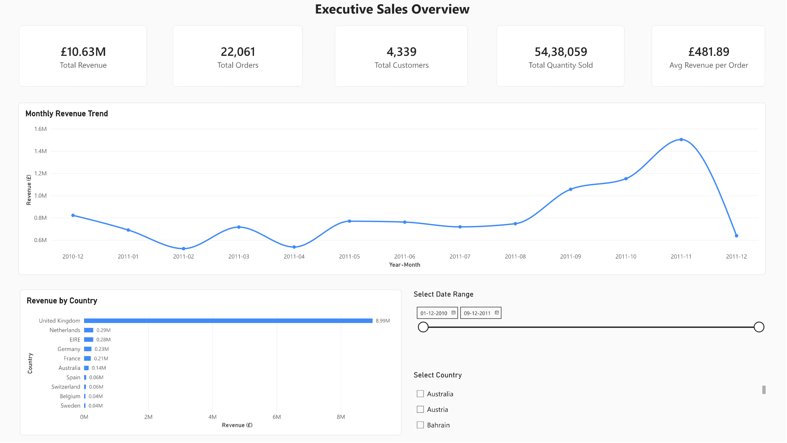
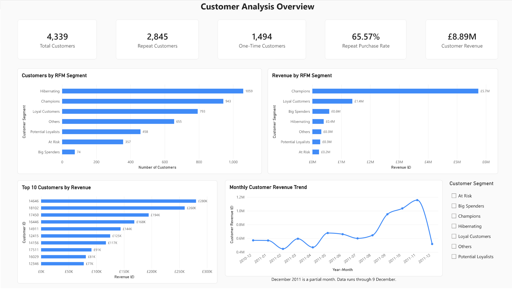
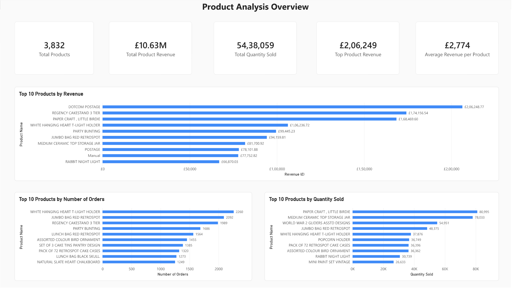

# Online Retail Sales & Business Performance Analysis

**End-to-End Data Analytics Portfolio Project | Excel • MySQL • Python • Power BI**

## Project Overview

This project analyzes historical transactions from a UK-based online retailer to evaluate sales performance, customer purchasing behaviour, product trends, and overall business performance.

The project demonstrates an end-to-end data analysis workflow using **Microsoft Excel, MySQL, Python, and Power BI**, covering data quality investigation, cleaning, exploratory analysis, SQL querying, customer segmentation, business insights, and interactive reporting.

The objective is to transform raw transactional data into meaningful insights that can support business decision-making.

## Key Business Insights

- **Total Sales Revenue:** £10,631,048.74 in eligible transaction revenue after excluding cancelled invoices and bad-debt adjustments.
- **Peak Sales Month:** November 2011 recorded the highest monthly revenue during the observed period.
- **Repeat Purchase Rate:** 2,845 of 4,339 identified customers purchased across multiple invoices, representing approximately 65.57%.
- **Customer Revenue Concentration:** The top 10% of identified customers contributed approximately 61.38% of customer revenue.
- **Customer Segmentation:** RFM analysis identified Champions, Loyal Customers, Big Spenders, At Risk, Hibernating, Potential Loyalists, and Others.
- **Product Performance:** Regency Cake Stand 3 Tier was among the highest-revenue physical products.
- **Customer Inactivity:** 1,449 identified customers had no eligible purchase during the final 90 days of the dataset period.

## Objectives

- Investigate missing values, duplicates, cancellations, and transaction anomalies.
- Analyze monthly, quarterly, country-level, and product-level sales performance.
- Evaluate customer purchasing behaviour, repeat purchasing, and revenue concentration.
- Identify high-performing products and frequently purchased product combinations.
- Segment customers using Recency, Frequency, and Monetary (RFM) analysis.
- Examine inactive customers and declining product sales.
- Develop interactive business reports using Power BI.
- Translate analytical findings into actionable business recommendations.

## Tools & Technologies

| Tool | Purpose |
|---|---|
| Microsoft Excel | Data quality investigation, PivotTables, PivotCharts, KPI cards, and dashboard development |
| MySQL | Data quality checks, joins, aggregations, CTEs, window functions, and advanced business analysis |
| Python | Data cleaning, exploratory analysis, customer segmentation, and product analysis |
| Pandas & NumPy | Data manipulation, transformation, and numerical analysis |
| Matplotlib & Seaborn | Exploratory data visualization |
| Power BI | Data modeling, DAX measures, KPI cards, interactive charts, and slicers |
| Git & GitHub | Version control, project organization, and documentation |

## Power BI Report Preview

The completed Power BI report contains three interactive pages covering executive sales performance, customer analysis, and product performance.

### 1. Executive Sales Overview

Displays total revenue, total orders, customers, quantity sold, average revenue per order, monthly revenue trends, and country-level performance.



### 2. Customer Analysis Overview

Focuses on customer revenue, repeat customers, one-time customers, repeat purchase rate, and customer purchasing behaviour.



### 3. Product Analysis

Analyzes product revenue, quantity sold, product counts, and top-performing products by revenue, quantity, and number of invoices.



### Power BI Report File

**[Download the Interactive Power BI Report (.pbix)](PowerBI/Online_Retail_Analysis.pbix)**

*The PBIX file requires Microsoft Power BI Desktop to open and interact with the report.*

## Project Structure

```text
Online-Retail-Analysis/
│
├── Data/
│   └── Original and processed datasets (stored locally)
│
├── Excel/
│   └── Documentation/
│       ├── Excel_Dashboard.pdf
│       └── Excel_Analysis_Summary.md
│
├── Sql/
│   ├── data_quality_checks.sql
│   ├── sales_analysis.sql
│   ├── customer_analysis.sql
│   ├── product_analysis.sql
│   ├── time_and_seasonal_analysis.sql
│   ├── advanced_business_analysis.sql
│   └── Sql_Business_Insights.md
│
├── Python/
│   ├── 01_data_understanding.py
│   ├── 02_data_cleaning.py
│   ├── 03_eda.py
│   ├── 04_sales_analysis.py
│   ├── 05_customer_analysis.py
│   ├── 06_product_analysis.py
│   └── Python_Business_Insights.md
│
├── PowerBI/
│   ├── Online_Retail_Analysis.pbix
│   └── Screenshots/
│       ├── executive-overview.png
│       ├── customer-analysis.png
│       └── product-analysis.png
│
└── README.md
```

*Note: The Data folder is maintained locally and excluded from Git. Dataset files can be obtained from the original source.*

## Dataset

**Source:** UCI Machine Learning Repository — Online Retail Dataset

[View Original Dataset](https://archive.ics.uci.edu/dataset/352/online+retail)

The dataset contains transactions from a UK-based online retailer between December 2010 and December 2011.

**Dataset Details**

| Attribute | Description |
|---|---|
| Original Records | 541,909 |
| Columns | 8 |
| Time Period | December 2010 – December 9, 2011 |
| Data Type | Transaction-level retail sales |
| Geographic Coverage | United Kingdom and international customers |

**Main Columns:** InvoiceNo, StockCode, Description, Quantity, InvoiceDate, UnitPrice, CustomerID, and Country.

## Excel Analysis — Completed

Excel was used for initial data quality investigation, exploratory analysis, PivotTables, PivotCharts, and dashboard development.

### Key Activities

- Identified missing customer IDs and product descriptions.
- Investigated duplicate transaction records.
- Examined cancelled invoices and negative quantities.
- Analyzed monthly sales trends.
- Compared country, customer, and product performance.
- Created KPI cards and interactive charts using PivotTables, PivotCharts, and slicers.

### Excel Dashboard and Documentation

- [View Excel Dashboard (PDF)](Excel/Documentation/Excel_Dashboard.pdf)
- [View Excel Analysis Summary](Excel/Documentation/Excel_Analysis_Summary.md)

## SQL Analysis — Completed

MySQL was used to investigate data quality, calculate business metrics, and perform advanced customer, product, and time-series analysis.

### SQL Scripts

1. `data_quality_checks.sql` — Missing values, duplicates, cancellations, and transaction anomalies.
2. `sales_analysis.sql` — Sales performance across time, countries, and products.
3. `customer_analysis.sql` — Customer revenue, order frequency, and repeat purchasing.
4. `product_analysis.sql` — Product performance, customer reach, and purchase frequency.
5. `time_and_seasonal_analysis.sql` — Monthly and quarterly sales trends and month-over-month changes.
6. `advanced_business_analysis.sql` — Revenue concentration, customer segmentation, inactive customers, declining product sales, new versus returning customer revenue, and product combinations.

### Selected SQL Findings

- **Revenue Concentration:** The top 10% of identified customers contributed approximately 61.38% of customer revenue.
- **Repeat Purchasing:** Approximately 65.57% of identified customers made purchases across multiple invoices.
- **Monthly Sales:** November 2011 recorded the highest monthly sales during the observed period.
- **Product Combinations:** Pink and red retrospot jumbo bags appeared together in 825 invoices.
- **Customer Inactivity:** 1,449 of 4,339 identified customers had no eligible purchase in the final 90 days of the dataset period.

**[View SQL Business Insights](Sql/Sql_Business_Insights.md)**

## Python Analysis — Completed

Python was used for data preparation, exploratory analysis, customer behaviour analysis, product performance analysis, and RFM customer segmentation.

**Libraries:** Pandas, NumPy, Matplotlib, and Seaborn.

### Python Scripts

1. `01_data_understanding.py` — Dataset structure, dimensions, data types, and initial inspection.
2. `02_data_cleaning.py` — Duplicate removal, date conversion, and cleaned dataset preparation.
3. `03_eda.py` — Exploratory data analysis, missing values, distributions, and business patterns.
4. `04_sales_analysis.py` — Revenue trends, monthly sales, invoice counts, and average revenue per invoice.
5. `05_customer_analysis.py` — Customer purchasing behaviour, repeat purchasing, recency, frequency, and RFM segmentation.
6. `06_product_analysis.py` — Product revenue, quantity sold, purchase frequency, and revenue contribution.

### Selected Python Findings

- **Eligible Sales Revenue:** £10,631,048.74 after excluding cancellation invoices and bad-debt adjustments.
- **Peak Revenue Month:** November 2011.
- **Repeat Customers:** 2,845 of 4,339 identified customers, representing a 65.57% repeat purchase rate.
- **Top Customer Contribution:** The top 10 customers contributed approximately 17.31% of identified-customer revenue.
- **RFM Segmentation:** Customers were classified into seven behavioural groups to support retention and customer value analysis.
- **Product Performance:** Regency Cake Stand 3 Tier was among the highest-revenue physical products, while Paper Craft Little Birdie showed unusually high quantity sales in a single invoice.

**[View Python Business Insights](Python/Python_Business_Insights.md)**

## Power BI Analysis — Completed

Power BI was used to develop a three-page interactive report for monitoring sales performance, customer behaviour, and product trends.

### Report Features

- Executive sales KPIs and monthly revenue trends.
- Country-level revenue comparisons.
- Customer revenue and repeat purchase analysis.
- Customer segmentation and purchasing behaviour.
- Product performance by revenue, quantity, and purchase frequency.
- Interactive charts and slicers.
- Data modeling and DAX measures for business metrics.

The report provides an accessible visual summary of the analytical findings.

## Business Recommendations

Based on the findings, the following actions could support business performance.

### 1. Improve Customer Retention

Use customer inactivity and RFM analysis to identify customers who may benefit from targeted re-engagement campaigns.

### 2. Reward High-Value Customers

Develop personalized loyalty offers for Champions and Loyal Customers to encourage continued purchasing.

### 3. Prepare for Seasonal Demand

Use monthly sales trends to support inventory planning and operational readiness ahead of historically high-demand periods.

### 4. Improve Product Strategy

Monitor high-revenue and frequently purchased products, investigate unusually large orders, and evaluate popular product combinations for cross-selling opportunities.

### 5. Monitor Revenue Concentration

Track dependence on high-value customers and explore opportunities to expand the active customer base.

*These recommendations are analytical proposals based on historical transaction data and have not been evaluated through business experiments.*

## Data Handling and Limitations

- Exact duplicate records were removed during data cleaning.
- Cancellation invoices beginning with `C` were excluded from ordinary sales analyses.
- Bad-debt adjustment records were excluded from ordinary sales and product performance analyses.
- Postage and other transaction line items were retained in overall transaction revenue where appropriate but should be excluded when evaluating physical merchandise performance.
- Negative quantities were not automatically removed from the cleaned master dataset because some may represent operational adjustments.
- Customer-level analysis includes only transactions with an identified `CustomerID`.
- The dataset ends on December 9, 2011, making December 2011 incomplete.
- Fourth-quarter 2010 comparisons require caution because only December 2010 is available.
- RFM segments depend on selected scoring thresholds and do not independently establish customer churn.
- Revenue calculations may differ depending on transaction filters and the treatment of cancellations, adjustments, and missing customer IDs.
- The dataset does not provide complete cost information, so revenue should not be interpreted as profit.

## Project Status

**Completed — End-to-End Data Analytics Project**

This project demonstrates practical Data Analyst skills across Excel, MySQL, Python, and Power BI, including data cleaning, exploratory analysis, SQL querying, customer segmentation, data visualization, and business recommendations.

The repository includes analysis scripts, business insights documentation, an Excel dashboard PDF, a Power BI report file, and report screenshots.